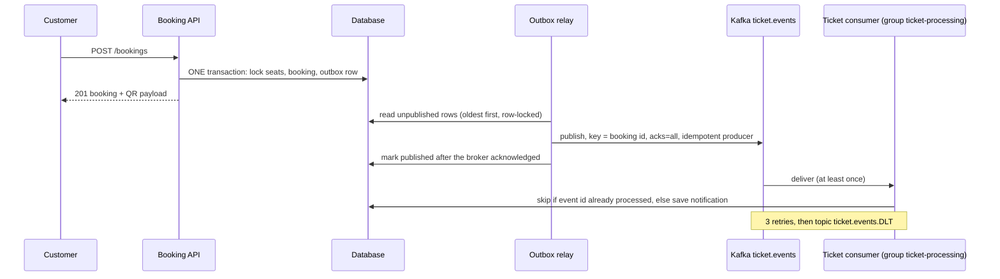
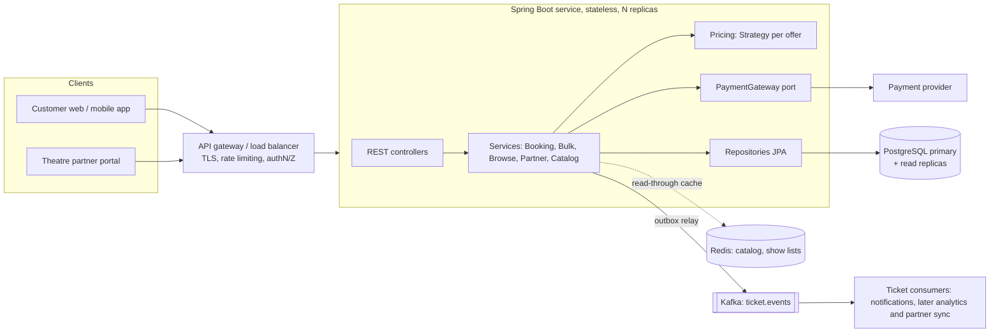
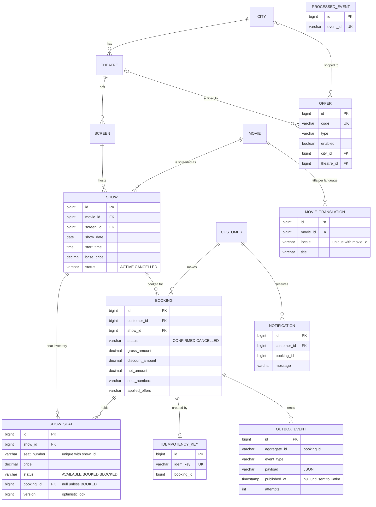

# Movie Ticket Booking Platform

B2B (theatre partners) and B2C (customers) movie ticket booking.

* **Java 17, Spring Boot 3**, root package `com.persistent.booking_platform`, Spring Data JPA, Spring Security (JWT),
  Apache Kafka, springdoc Swagger UI, H2 for local runs and PostgreSQL (Aurora on AWS) for real environments.
* **React 18 (Vite)** front end in `frontend/`.
* **AWS** reference infrastructure as Terraform in `infra/terraform/`, GitHub Actions pipeline in `.github/workflows/ci.yml`.
* **OpenAPI 3 specification** in `docs/openapi.yaml` (33 operations, schemas, security, error responses), served live by Swagger UI; a test fails when the file and the controllers differ.
* Tests: JUnit 5, Mockito, MockMvc, embedded Kafka, JaCoCo gate at 80% line coverage.

## Run locally

Prerequisites: Java 17+, Maven 3.9+, Node 18+ (for the UI), Docker (only for Kafka).

**Option 1: backend with Kafka (recommended)**
```bash
./run-local.sh            # Windows: run-local.bat
```
This starts Kafka (KRaft, single broker) and Kafka UI in Docker, then runs the backend on an in-memory H2 database
with Kafka switched on (Spring profile `local`). Without the script:
```bash
docker compose up -d kafka kafka-ui
mvn spring-boot:run -Dspring-boot.run.profiles=local
```
No Docker? Install Kafka yourself and point the app at it; see [docs/LOCAL_KAFKA.md](docs/LOCAL_KAFKA.md).

**Option 2: backend without Kafka** (no Docker needed; events stay in the `outbox_event` table)
```bash
./run-local.sh nokafka    # or: mvn spring-boot:run
```

**Frontend** (second terminal): `cd frontend && npm install && npm run dev`

**Everything in containers** (PostgreSQL, Kafka, backend, nginx UI): `docker compose up --build`

| What | URL |
|---|---|
| React UI (dev server) | http://localhost:5173 (container: http://localhost:3000) |
| **Swagger UI** | http://localhost:8080/swagger-ui.html |
| OpenAPI JSON / YAML (live) | http://localhost:8080/v3/api-docs and http://localhost:8080/v3/api-docs.yaml |
| OpenAPI specification file | [docs/openapi.yaml](docs/openapi.yaml) (import it into Postman, Insomnia or a code generator) |
| H2 console | http://localhost:8080/h2-console (JDBC URL `jdbc:h2:mem:movies`, user `sa`, empty password) |
| Kafka UI (topics, messages, consumer groups) | http://localhost:8090 |

Tests: `mvn verify` (all tests, JaCoCo report in `target/site/jacoco`, fails below 80% line coverage; the Kafka test
uses an embedded broker, no Docker needed) and `cd frontend && npm test`.

**Demo accounts** (created at start-up when `app.seed-demo-data=true`, never in production):

| Role | Email | Password |
|---|---|---|
| Customer | `demo@example.com` | `Demo@12345` |
| Theatre partner (owns "Cinema Palace") | `partner@example.com` | `Partner@12345` |
| Administrator | `admin@example.com` | `Admin@123456789` |

**Try the whole flow:**
1. React UI: sign in as the demo customer, pick Nagpur, a movie and tomorrow's date, choose a show and seats (the third
   seat gets 50% off, the 14:00 show 20% off), confirm the booking, then press **Pay now (demo payment gateway)**. The QR
   code appears. "My bookings" has cancel and reschedule and the messages created through Kafka.
2. Swagger UI: `POST /api/v1/auth/login`, press **Authorize**, paste the token, then call the other endpoints.
3. Kafka UI (http://localhost:8090): topic `ticket.events` shows one message per booking change, keyed by booking id.
4. Send the same `Idempotency-Key` header twice to `POST /api/v1/bookings` to see that no second booking is created.

## Security, payments and operations

* **Sign-in:** JWT access tokens (HS256, 60 minutes) from `POST /api/v1/auth/login`; customers register at
  `/auth/register`, partners at `/auth/register-partner`. Passwords are stored with BCrypt (cost 12); 5 wrong passwords lock
  the account for 15 minutes; wrong email and wrong password give the same message.
* **Roles:** `CUSTOMER` (book, cancel, reschedule), `PARTNER` (partner API), `ADMIN` (cities, movies, offers, actuator).
  Object-level checks: a customer only sees their own bookings, a partner only manages theatres they onboarded; other
  people's resources answer "not found". Browse endpoints are public.
* **Payments (hold flow):** a booking is created as `PENDING_PAYMENT` and holds the seats for 10 minutes. The payment
  provider calls `POST /api/v1/payments/webhook` (HMAC-SHA256 signed body in `X-Signature`); a valid `SUCCEEDED` event
  confirms the booking and creates the QR code, `FAILED` releases the seats. A scheduled job releases unpaid holds, and a
  payment that arrives after the hold expired is refunded. Locally, the demo gateway endpoint
  `POST /api/v1/payments/simulator/{bookingId}/pay` plays the provider (disable with `PAYMENT_SIMULATOR=false`).
  `PAYMENT_MODE=immediate` skips the hold and charges inside the booking (used by most tests).
* **Limits:** per-address rate limits on sign-in and booking calls (HTTP 429); security headers; CORS allow-list.
* **Operations:** `/actuator/health` (liveness and readiness probes, public), `/actuator/prometheus` (admin only),
  request id in every log line and in the `X-Request-Id` header, graceful shutdown, no stack traces in responses.

### Configuration (environment variables)

| Variable | Purpose | Default (local only) |
|---|---|---|
| `JWT_SECRET` | signs access tokens (32+ characters) | dev value, **change it** |
| `QR_SECRET` | signs QR codes (16+ characters) | dev value, **change it** |
| `PAYMENT_WEBHOOK_SECRET` | signs payment webhooks (16+ characters) | dev value, **change it** |
| `PAYMENT_MODE`, `PAYMENT_SIMULATOR` | `hold` or `immediate`; demo gateway on or off | `hold`, `true` |
| `BOOTSTRAP_ADMIN_EMAIL`, `BOOTSTRAP_ADMIN_PASSWORD` | creates the first admin (password 12+ characters) | empty |
| `DB_URL`, `DB_USER`, `DB_PASSWORD`, `DDL_AUTO` | PostgreSQL with `SPRING_PROFILES_ACTIVE=postgres` | H2 in memory |
| `APP_KAFKA_ENABLED`, `KAFKA_BOOTSTRAP`, `KAFKA_REPLICAS` | Kafka switch, address, topic replication | off, localhost, 1 |
| `CORS_ORIGINS`, `SWAGGER_ENABLED`, `H2_CONSOLE`, `APP_SEED_DEMO_DATA` | origin allow-list; switch Swagger, H2 console, demo data | local-friendly |

### AWS and delivery

`infra/terraform/` describes the target (VPC over 3 AZs, Aurora PostgreSQL writer and reader, MSK with 3 brokers, ECS
Fargate service behind an ALB with WAF, Secrets Manager, S3 and CloudFront for the web app). It has not been applied or
validated by the authors; run `terraform validate` and `terraform plan` first. `.github/workflows/ci.yml` runs the
Maven build with the coverage gate, the front-end tests and build, a Trivy scan of dependencies and images, and builds
both Docker images.

## Kafka event pipeline (real-time ticket processing)



* **Why an outbox:** a Kafka send inside the booking transaction could succeed while the database rolls back (or the
  reverse). Writing the event as a row in the same transaction guarantees *event exists if and only if booking
  committed*. The relay then delivers it **at least once**.
* **Ordering:** key = booking id, so confirm, reschedule and cancel of one booking arrive in order. The relay stops at
  the first failed row, so order is kept across failures.
* **Duplicates:** the consumer stores each `eventId` (unique) and ignores repeats, so processing is effectively once.
* **Failures:** consumer retries 3 times (1 second apart) and then parks the message on `ticket.events.DLT`.
* **Scaling:** 6 partitions, consumers run with concurrency 3 per instance; add instances to the same group to scale.
* **Switch:** `app.kafka.enabled` (default `false`). When off, nothing needs a broker and events wait in the outbox.
* Events: `BOOKING_CONFIRMED`, `BOOKING_RESCHEDULED`, `BOOKING_CANCELLED` (reason `CUSTOMER_REQUEST` or
  `SHOW_DELETED`). Code: `event` package, `OutboxService`, `TicketProcessingService`.

## What is implemented

| Requirement | Where |
|---|---|
| Browse theatres by movie, city, date with show times, free seats and offers | `GET /movies/{id}/theatres`, UI "Book tickets" |
| Browse movies by city, language, genre; localised titles | `GET /cities/{id}/movies?language=&genre=` + `Accept-Language`, `POST /movies/{id}/translations` |
| Offers: 50% on third ticket, 20% on afternoon shows, per city or theatre | `pricing` package (Strategy pattern), `POST /offers` |
| **QR code with every booking** (signed, verifiable at the entrance) | `GET /bookings/{id}/qr`, `GET /partner/tickets/verify`, `QrCodeService` |
| Book, cancel, reschedule end to end (with idempotency key) | `BookingService`, UI "Book tickets" and "My bookings" |
| Bulk booking and cancellation (partial or all-or-nothing) | `BulkBookingService` |
| Theatres create, update, delete shows; allocate seat inventory | `PartnerService`, UI "Theatre partner" |
| Theatres with existing systems: bulk show import | `POST /partner/shows/import` |
| **Apache Kafka** real-time ticket processing (outbox, relay, idempotent consumer, retries, dead-letter topic) | `event` package, `OutboxService`, `TicketProcessingService`, `GET /customers/{id}/notifications` |
| **Login, roles and ownership checks** (JWT, BCrypt, lock-out, rate limits) | `security` package |
| **Seat hold with payment webhook**, expiry job, late-payment refund | `payment` package, `BookingService` |
| **Swagger / OpenAPI** documentation of every endpoint | `OpenApiConfig`, `@Operation` and `@Tag` on controllers, `/swagger-ui.html` |
| Concurrency, ACID, meaningful errors, security headers, CORS | see below and `docs/ARCHITECTURE.md` |

**Non-functional design** (transactions, existing theatre systems, localisation, scale and 99.99% on AWS, payment
gateways, monetisation, OWASP Top 10): see [docs/ARCHITECTURE.md](docs/ARCHITECTURE.md).

## High level architecture


Implemented here: the service, PostgreSQL or H2, the payment port, Kafka (outbox, relay, consumer) and Swagger. Cache
and real email or SMS delivery are planned extension points (see "Not implemented").

## Entity relationship diagram



## Concurrency and ACID

| Concern | Solution |
|---|---|
| Two users take the same seat | `ShowSeat` rows are locked with `SELECT ... FOR UPDATE` (`PESSIMISTIC_WRITE`) inside the booking transaction. The second transaction waits, then sees `BOOKED` and gets `409 SEAT_UNAVAILABLE`. |
| Deadlocks between overlapping multi-seat bookings | Every locking query is `ORDER BY id`, so all transactions take row locks in the same global order. |
| Lost update safety net | `@Version` on `ShowSeat` and `Booking`; a stale write fails and is returned as `409 CONCURRENT_MODIFICATION`. |
| Double booking at DB level | `UNIQUE (show_id, seat_number)` on `show_seat`; a seat row has exactly one `booking_id`. |
| Atomicity | `book`, `cancel`, `reschedule`, `deleteShow` are single `@Transactional` methods: seats, booking row and payment call commit or roll back together. |
| Consistency | Status transitions are validated (`AVAILABLE -> BOOKED -> AVAILABLE`), amounts are `DECIMAL(10,2)`, bookings reference seats by FK. |
| Isolation | `READ_COMMITTED` plus row locks on exactly the contended rows (no table or show-wide lock, so different seats of one show book in parallel). |
| Durability | PostgreSQL WAL; payment and booking are in the same transaction boundary. |
| Reschedule | One locking statement for the old seats and the new seats, then swap, re-price and charge or refund the difference. |
| Cancel vs cancel | The booking row is locked (`findForUpdate`), so the second cancel gets `BOOKING_ALREADY_CANCELLED`. |
| Scheduling two shows on one screen | The `Screen` row is locked while checking overlap. |

## Design patterns and principles

* **Strategy**: `DiscountStrategy` (`ThirdTicketDiscountStrategy`, `AfternoonShowDiscountStrategy`); new offers are new classes (open/closed).
* **Ports and adapters**: `PaymentGateway` interface with `SimulatedPaymentGateway`.
* **Layering**: controller -> service -> repository; DTO records at the boundary, entities never leave the service layer.
* **Rich domain**: `ShowSeat.book/release`, `Booking.moveTo/cancel`, `Offer.appliesTo`, `Show.endDateTime`.
* **Centralised error handling**: `GlobalExceptionHandler` returns `{timestamp, status, code, message, details[]}`.
* **Testability**: injected `Clock` for time rules (start of show, cancellation window).

## Business rules (assumptions)

* Offers are switched on per scope with the `offer` table (theatre, city, or everywhere): `POST /api/v1/offers`.
* "Third ticket": the third seat in the order the customer selected them gets 50% off (one per booking).
* "Afternoon show": start time from 12:00 inclusive to 17:00 exclusive gets 20% off every ticket.
* Discounts are **not stacked**; each ticket gets the best single discount (third ticket of an afternoon show: 50%).
* Max 10 seats per booking. Cancel or reschedule is allowed until 2 hours before the show; full refund.
* Reschedule: same movie, a different show, same number of seats; price difference is charged or refunded.
* Deleting a show cancels and refunds its bookings, blocks the remaining seats and keeps the history (soft delete).
* Show time cannot be edited once seats are booked (delete the show instead). Overlap check includes 15 minutes turnaround.
* Bulk operations: default is partial success with a per-item result; `allOrNothing=true` runs one transaction.

## API summary

| Method and path | Purpose |
|---|---|
| `GET /api/v1/movies/{movieId}/theatres?cityId=&date=` | Theatres running the movie, with show timings, free seats and offers |
| `GET /api/v1/shows/{id}/seats`, `GET /api/v1/shows/{id}/quote?seats=A1,A2` | Seat map, price preview |
| `POST /api/v1/bookings`, `GET /api/v1/bookings/{id}`, `GET /api/v1/customers/{id}/bookings` | Book, read |
| `DELETE /api/v1/bookings/{id}` | Cancel |
| `PUT /api/v1/bookings/{id}/reschedule` | Re-schedule |
| `POST /api/v1/bookings/bulk`, `POST /api/v1/bookings/bulk-cancel` | Bulk book and cancel |
| `POST /api/v1/partner/theatres`, `POST /api/v1/partner/theatres/{id}/screens` | Onboard theatre and screens |
| `POST /api/v1/partner/shows`, `PUT /api/v1/partner/shows/{id}`, `DELETE /api/v1/partner/shows/{id}` | Create, update, delete shows |
| `PUT /api/v1/partner/shows/{id}/seats` | Allocate and update seat inventory (price, block, add) |
| `POST /api/v1/cities`, `/movies`, `/customers`, `/offers` and matching `GET` lists | Reference data |

## Non-functional notes

* **Scalability**: stateless service, horizontal scaling; contention is limited to the rows of the seats being booked; indexes on `(show_id, status)`, `(screen_id, show_date)`, `booking(customer_id)`.
* **Availability**: replicas behind a load balancer, PostgreSQL primary with replicas; browse queries can move to replicas and a cache.
* **Security**: not implemented (see below); planned JWT with roles `CUSTOMER`, `PARTNER`, `ADMIN` and partner-to-theatre ownership checks.
* **Observability**: SLF4J logging of concurrency conflicts; Actuator and metrics are planned.

## Not implemented (noted for the discussion round)

* A real payment provider adapter (Razorpay, Stripe, PayU). The port, the signed webhook contract, the seat hold and the
  refund path are built and tested with the simulated gateway; an adapter only translates the provider's API and webhook.
* Database migrations (Flyway). The schema is created by Hibernate (`ddl-auto=update`); add a baseline migration and
  switch to `validate` before a real launch.
* Partner approval workflow (anyone can sign up as a partner and onboard theatres), password reset and email
  verification, multi-factor sign-in. On AWS the design uses Cognito for these (see `docs/ARCHITECTURE.md`).
* Real email or SMS delivery (notifications are stored and logged only), Kafka TLS and login for the local broker,
  Redis (shared lock-out and rate-limit counters, catalogue cache).
* Front-end component tests (only helper functions are tested) and UI translation (only movie titles are localised).
* Terraform and the CI workflow were written without being run; the whole code base was written without a Maven or npm
  download in the authoring environment, so run `mvn verify` and `npm install && npm test` first and fix anything they
  report.
