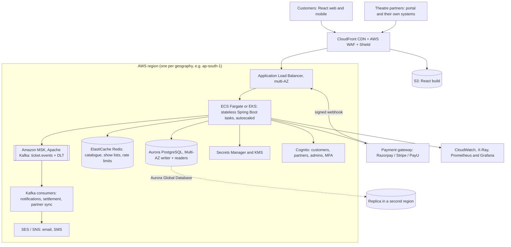

# Architecture and Non-Functional Design

Each section says what is **implemented in this repository** and what is **design only**.

## 1. Target architecture on AWS

Implemented: the stateless Spring Boot service (package `com.persistent.booking_platform`), PostgreSQL support, React UI, JWT security, the payment hold flow, Dockerfiles, `docker-compose.yml`, Terraform in `infra/terraform` (unvalidated) and the CI workflow.
Implemented: the outbox, Kafka producer relay, idempotent consumer with retries and dead-letter topic (run it locally with `./run-local.sh`). Design only: Terraform/CDK for the AWS resources above (including the MSK cluster, 3 brokers, replication factor 3, TLS and IAM authentication), Cognito, Redis, and real email/SMS delivery.

## 2. Transactional scenarios and design decisions

| Scenario | Decision | Status |
|---|---|---|
| Two customers pick the same seat | Row lock on `show_seat` (`SELECT ... FOR UPDATE`), seats re-validated after the lock; loser gets `409 SEAT_UNAVAILABLE`. Unique key `(show_id, seat_number)` and `@Version` as safety nets. | Implemented, tested with 20 concurrent buyers |
| Overlapping multi-seat bookings | All locking queries `ORDER BY id`, so locks are always taken in the same order (no deadlock cycles). Database deadlock detection is the last resort and is reported as `409 CONCURRENT_MODIFICATION`. | Implemented |
| Booking is all-or-nothing | One `@Transactional` method: lock, validate, price, create booking, mark seats, charge. Any failure rolls everything back. | Implemented |
| Double click or network retry | `Idempotency-Key` header: the key is stored with the booking (unique), a retry returns the original booking. The UI reuses one key per attempt. | Implemented |
| Cancel and reschedule | Booking row locked first (second cancel fails with `BOOKING_ALREADY_CANCELLED`); reschedule locks old and new seats in one statement, swaps seats, re-prices and charges or refunds only the difference. | Implemented |
| Show deleted by the theatre | Bookings cancelled and refunded, seats blocked, show kept as `CANCELLED` (soft delete keeps history and reports correct). | Implemented |
| Two shows scheduled on one screen | Screen row locked while the overlap check runs. | Implemented |
| Bulk operations | Default: each item in its own transaction, per-item result (partial success). `allOrNothing=true`: one transaction, whole batch rolls back. | Implemented |
| Payment succeeds but booking fails, or the reverse | **Seat-hold flow**: the booking is created as `PENDING_PAYMENT` and the seats are held for 10 minutes; the customer pays on the provider's page; a signed, idempotent webhook confirms the booking (QR code and `BOOKING_CONFIRMED` event are created only then); `FAILED` or a timeout releases the seats (`HoldExpiryJob`); a payment that arrives after expiry is refunded. A nightly reconciliation job against the provider is design only. | Implemented with a simulated provider; real adapter design only |
| Events (email, SMS, partner sync) | Transactional outbox: the event row is written in the booking transaction; a relay publishes it to Kafka topic `ticket.events` (key = booking id, `acks=all`, idempotent producer) after commit, in order, at least once. Consumers de-duplicate by event id, retry 3 times and then use `ticket.events.DLT`. | Implemented, tested with an embedded Kafka broker |

Isolation level is `READ_COMMITTED` plus targeted row locks. A higher isolation level (SERIALIZABLE) would make
popular shows fail with serialisation errors under load; locking only the contended rows keeps different seats of the
same show bookable in parallel.

### 2a. Kafka event pipeline

* **Topics:** `ticket.events` (6 partitions, key = booking id) and `ticket.events.DLT` (dead letters). Replication factor 1
  locally, 3 on MSK with `min.insync.replicas=2`.
* **Guarantees:** producer `acks=all` plus idempotence; relay marks a row published only after the broker acknowledged
  it; consumer commits offsets per record after the database transaction. Delivery is at least once and processing
  is effectively once because of the `processed_event` unique key.
* **Why not call Kafka inside the booking transaction:** a database rollback cannot undo a sent message, and a broker
  outage would block bookings. With the outbox, bookings keep working while Kafka is down and the backlog is sent when
  it returns (`outbox_event.attempts` and `last_error` show the problem; alert when the oldest unpublished row is older than
  one minute).
* **More consumers (design):** each new service uses its own consumer group on the same topic: analytics and
  dashboards, partner inventory sync (push the sale to the theatre system), settlement and invoicing, and a push channel
  (WebSocket or server-sent events) for live seat maps.
* **Throughput:** one booking produces about one small message per state change; 6 partitions and 3 consumer threads per
  instance handle thousands of events per second, and partitions can be increased for new keys.
* **Multi-instance relay:** the relay reads pending rows with a row lock, so two instances never publish the same row at
  once; a leader-elected single relay or Debezium change-data-capture is the next step at very high volume.

## 3. Theatres with existing IT systems, new theatres, localisation

**New theatres (no system):** self-service partner portal and APIs (implemented): onboard a theatre, add screens,
create, update and delete shows, allocate and block seats.

**Theatres with their own system:**
* *Push import* (implemented): `POST /api/v1/partner/shows/import` accepts a list of shows; every show is validated
  and saved in its own transaction; the response lists what was imported and what failed and why.
* *Seat inventory sync* (implemented endpoints, connector is design only): the theatre system calls
  `PUT /partner/shows/{id}/seats` to block seats it sold at its own counter, so the platform never oversells.
  Rule: **one system is the owner of each show's inventory**; the other side only reserves through the owner's API.
* *Adapters per theatre system* (design): an anti-corruption layer (one adapter class per vendor, Strategy pattern)
  translates the vendor format to the canonical model (`ShowRequest`, `SeatInventoryRequest`). Transport options:
  vendor REST API polled by a scheduled worker, SFTP/CSV drop picked up through S3 events, or webhooks.
  Failures go to a dead-letter queue and are visible in the partner portal.
* *Authentication of partners* (design): API keys or OAuth2 client credentials per theatre, scoped to that theatre.

**Localisation:**
* Catalogue: `movie_translation` (movie, language, title). `GET /cities/{id}/movies` follows the `Accept-Language`
  header and falls back to the original title (implemented); filters by language and genre (implemented).
* Error messages carry a stable `code`; the UI maps codes to translated text (React i18n library, design only).
* Money and time (design): store the currency per theatre country, show times as local time plus the theatre's time
  zone id, format dates and amounts on the client with `Intl`. The UI already formats amounts with `toLocaleString`.

## 4. Scaling to many cities and countries, 99.99% availability

99.99% allows about **52 minutes of downtime per year**. The approach:

1. **No single point of failure inside a region.** Multi-AZ ALB, at least 3 stateless tasks across 3 AZs with
   autoscaling, Aurora Multi-AZ with automatic failover (typically under 60 seconds), Redis with replicas.
2. **Partition by geography ("cells").** A show belongs to one city and a city belongs to one regional cell.
   Seat inventory needs a single writer, so each cell has its own database and a failure or deployment problem affects
   one region, not the world. A global router (Route 53 latency/geo routing) sends users to their cell.
3. **Disaster recovery.** Aurora Global Database replicates to a second region (RPO of seconds, RTO of minutes);
   a game-day drill is run regularly. Writes for a cell move to the standby region only on a regional failure.
4. **Read scalability.** Browse traffic is the bulk: cache movie lists and show lists in CloudFront and Redis (short
   TTL, invalidated when a show changes) and read from Aurora replicas. Only seat maps and bookings hit the writer.
5. **Write scalability for launch spikes.** Booking contention is per show, not global, so it scales out with shards by
   city. For blockbuster launches add a virtual waiting room (queue token) in front of the booking API and rate limit
   per user with WAF and Redis.
6. **Graceful degradation.** If notifications or recommendations fail, booking still works; if the payment gateway is
   down, the circuit breaker shows a clear message and browsing stays up. Use multiple gateways with failover.
7. **Safe releases.** Blue/green or canary deployments with automatic rollback on error-rate alarms; backward compatible
   database migrations (Flyway, expand then contract).
8. **Measure it.** SLOs (availability, p99 latency of booking), health checks, synthetic bookings every minute,
   alerts on error budget burn, distributed tracing.

Honest caveat: the composite availability is limited by the least available dependency in the booking path
(payment gateway, DNS, the cloud region). 99.99% is achievable for browsing and for bookings in a healthy cell;
for the payment step it depends on the gateway's own SLA, which is why holds, retries and reconciliation exist.

## 5. Payment gateway integration

* `PaymentGateway` is the port (`createOrder`, `charge`, `refund`); `SimulatedPaymentGateway` is the adapter implemented.
* Provider adapters (Razorpay, Stripe, PayU) implement the same port, selected per country by configuration; a router can
  fail over between providers. **Design only:** only the simulated adapter exists.
* Card data never touches our servers (hosted fields or redirect), which keeps the platform at PCI DSS SAQ A.
* **Implemented flow:** booking creates an order reference and holds the seats; the provider's callback arrives at
  `POST /api/v1/payments/webhook` with an HMAC-SHA256 signature over the raw body (constant-time comparison). Each adapter
  maps its provider's webhook to `{eventId, bookingId, paymentReference, status: SUCCEEDED|FAILED}`. Handling is
  idempotent by booking state: repeated deliveries return `ALREADY_CONFIRMED`; a late success after the hold expired is refunded.
* Refunds: cancel, show deletion and reschedule differences call `refund`. **Design only:** store refunds in an outbox and
  retry with an idempotency key until the provider confirms.
* Settlement (design): per-theatre ledger (sales, fees, refunds) and scheduled payouts minus the platform commission.

## 6. Monetisation

1. **Convenience fee** per ticket (flat or percentage), shown before payment.
2. **Commission** on ticket value from theatres, or a **SaaS subscription** for theatres that only want the tools.
3. **Food and beverage pre-orders** and add-ons (parking, merchandise) with margin.
4. **Promoted listings and advertising**: sponsored movie placement, studio and brand campaigns, trailer ads.
5. **Offer co-funding**: studios or brands fund discounts such as the third-ticket offer in return for visibility.
6. **Membership** (free cancellation, no convenience fee, early access) and **gift cards**.
7. **Data products**: anonymised demand and pricing insights for theatres and distributors; **dynamic pricing**
   tools for partners with a revenue share.

## 7. OWASP Top 10 (2021) mapping

| Risk | Protection | Status |
|---|---|---|
| A01 Broken access control | Roles `CUSTOMER`, `PARTNER`, `ADMIN` enforced per URL; object-level checks in `AccessGuard` (own bookings only, own theatres only, other people's resources answer "not found" so ids cannot be probed); admin-only reference data; deny by default for unknown paths. | Implemented, tested in `SecurityIT` |
| A02 Cryptographic failures | BCrypt (cost 12) for passwords; HMAC-signed JWTs, QR codes and payment webhooks, compared in constant time; secrets from environment or Secrets Manager (startup fails on short secrets). TLS and KMS encryption at rest come from the AWS setup (ALB, Aurora, MSK, S3). No card data stored. | Application part implemented; TLS and encryption at rest in Terraform (unvalidated) |
| A03 Injection | Spring Data parameter binding (no string-built SQL), Bean Validation on every request, strict seat-number and password patterns, React escapes output, JSON-only API. | Implemented |
| A04 Insecure design | Seat hold with expiry, idempotency keys, limits (10 seats per booking, 50 per bulk call), per-address rate limiting (429), AWS WAF rate rule. | Implemented; WAF in Terraform |
| A05 Security misconfiguration | Security headers (CSP, `nosniff`, frame deny, HSTS), CORS allow-list, generic error responses without stack traces, Swagger and H2 console switchable off (off in the Terraform task), non-root container user, least-privilege secrets access. | Implemented |
| A06 Vulnerable components | Pinned dependency versions, Trivy scan of dependencies, secrets, configuration and images in CI; Dependabot recommended. | CI workflow (not run yet) |
| A07 Identification and authentication failures | Lock-out after 5 failed sign-ins, same message for unknown email and wrong password (with equal work), short-lived tokens, password policy, no "find customer by email" endpoint. Design only: MFA and password reset through Cognito. | Implemented except MFA and reset |
| A08 Software and data integrity failures | Signed webhooks and QR codes, immutable image tags in ECR, CI before deploy. Design only: signed artifacts and protected branches. | Partly implemented |
| A09 Logging and monitoring failures | Request id on every log line and response, conflict and failed-publish warnings, health and Prometheus metrics. Design only: audit log table for partner changes, alerts on failed signature checks and on error budget burn. | Partly implemented |
| A10 Server-side request forgery | The service never fetches user-supplied URLs. If partner webhooks or URL imports are added: allow-list hosts, block private ranges, egress through a proxy. | Not applicable today |

## 8. Operations

* **Health:** `/actuator/health/liveness` and `/actuator/health/readiness` for the container health check and the ALB.
* **Metrics:** `/actuator/prometheus` (admin only) for Prometheus or CloudWatch agent scraping; alert on booking error
  rate, p99 latency, outbox backlog (oldest unpublished row), consumer lag and dead-letter topic size.
* **Deployments:** ECS rolling update with circuit breaker and automatic rollback, graceful shutdown (30 seconds) so
  in-flight bookings finish, at least 3 tasks over 3 AZs, CPU-based autoscaling.
* **Secrets:** Secrets Manager injects `DB_PASSWORD`, `JWT_SECRET`, `QR_SECRET` and `PAYMENT_WEBHOOK_SECRET` as
  environment variables; rotate by creating a new secret version and redeploying (tokens signed with the old secret stop
  working, so schedule rotation).
* **Backups and recovery:** Aurora automated backups for 14 days and a final snapshot; MSK has 3 brokers with replication
  factor 3; run restore and failover drills.
